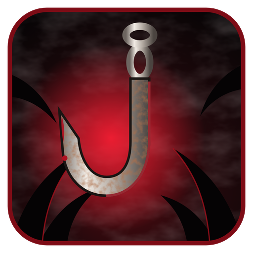

# DbD Rich Presence

[](https://github.com/TomasLinka1234/DBD-Rich-Presence/actions/workflows/build.yml)
[](https://github.com/TomasLinka1234/DBD-Rich-Presence/releases/latest)
[](LICENSE)




Discord status pro **Dead by Daylight**: živě ukazuje, **koho hraješ**, **na jaké mapě**,
**jak dlouho zápas běží** a v lobby i **prestige** tvé postavy.

```
Dead by Daylight
Killer: The Krasue
Rotten Fields (Coldwind Farm)
12:34 uplynulo
```

*English summary [below](#english).*

## Stažení

**[⬇ DbD-Rich-Presence.exe](https://github.com/TomasLinka1234/DBD-Rich-Presence/releases/latest/download/DbD-Rich-Presence.exe)**
(jeden soubor, nic se neinstaluje)

1. Stáhni `DbD-Rich-Presence.exe` a dej ho, kam chceš (třeba do Dokumentů).
2. Spusť ho. Když Windows ukáže *„Systém Windows ochránil počítač“*, klikni na
   **Další informace → Přesto spustit** (program není podepsaný placeným certifikátem, viz níž).
3. Na otázku, jestli se má spouštět se zapnutím Windows, dej **Ano**.

Hotovo. Program běží na pozadí s ikonkou vpravo dole u hodin a sám počká, až zapneš hru.
Ve hře nastav **Windowed Fullscreen** a angličtinu, v Discordu musí být zapnuté
**Sdílet svou aktivitu**. Podrobnosti jsou v **[NAVOD.md](NAVOD.md)**.

## Co umí

- postava včetně legendárních skinů (Rize Kamishiro = The Ghoul), mapa a čas zápasu
- velký portrét postavy a malá ikona mapy, v lobby místo ní odznak prestige
- **statistiky**: počítá zápasy, útěky a zabití; v Discordu ukáže třeba „Dnes 4 zápasy · 3 výhry“
  a po zápase výsledek, v menu ikonky je přehled podle postav a map
- běh na pozadí bez okna, spouštění se zapnutím Windows, nastavení z menu ikonky
- nové postavy, mapy a skiny si sám jednou denně doplní z [DbD wiki](https://deadbydaylight.wiki.gg)

## Je to bezpečné?

Celý program je **open source**: všechno, co dělá, je v tomhle repozitáři a dá se přečíst.

- **Nesahá na hru.** Nečte její paměť, nemění soubory, nic do ní nevkládá. Jen fotí okno hry
  (stejně jako OBS nebo Discord při streamování) a text z něj čte OCR **přímo u tebe v počítači**.
  Není to mod ani cheat, hra o něm vůbec neví.
- **Nic neodesílá.** Žádná telemetrie ani screenshoty na internet. Statistiky zápasů zůstávají
  jen u tebe v počítači. Připojuje se jen k Discordu
  (status), k veřejnému seznamu obrázků Discord aplikace a nejvýš 1× denně na DbD wiki.
  Úplný seznam je v [SECURITY.md](SECURITY.md).
- **Nepotřebuje správce.** Do systému zapíše jen hodnotu pro spuštění se zapnutím Windows
  (to samé místo, které používá Discord nebo Steam) a jde to vypnout v menu ikonky.
- **`.exe` nikdo nesestavuje ručně.** Vyrábí ho [GitHub Actions](../../actions) z kódu v tomhle
  repozitáři (`.github/workflows/build.yml`). Před každým sestavením proběhnou testy a ve vydání
  je otisk SHA256, commit a odkaz na záznam sestavení.

**Ověření staženého souboru** (že je opravdu z tohohle kódu):

```powershell
# otisk musí sedět s tím v popisu vydání
Get-FileHash .\DbD-Rich-Presence.exe -Algorithm SHA256

# podepsané potvrzení od GitHubu, že soubor vznikl v Actions tohohle repozitáře
gh attestation verify DbD-Rich-Presence.exe --repo TomasLinka1234/DBD-Rich-Presence
```

Soubor můžeš nahrát i na [VirusTotal](https://www.virustotal.com). Programy zabalené nástrojem
PyInstaller a bez placeného podpisu občas některý méně známý antivirus označí jako podezřelé
(falešný poplach). Kdo nechce věřit `.exe`, spustí program přímo ze zdrojáků nebo si ho sestaví
sám (viz níž).

## Jak to funguje

```
okno hry ──snímek──> OCR (RapidOCR, offline) ──text──> rozpoznání ──stav──> Discord
                                                       postava, mapa,        Rich Presence
                                                       lobby, zápas
```

| Soubor | Co dělá |
|---|---|
| `app/main.py` | vstupní bod (`.exe` i zdrojáky) |
| `app/pozadi.py` | ikonka u hodin, menu, první spuštění, `--self-test` |
| `app/runner.py` | hlavní smyčka: čeká na hru, načte OCR, po zavření hry ho zase uvolní |
| `app/capture.py` | najde okno Dead by Daylight a vyfotí ho (dxcam / mss) |
| `app/ocr.py` | čtení textu z výřezu obrazovky (RapidOCR + onnxruntime na CPU) |
| `app/detect.py` | které části obrazovky číst: tlačítko PLAY/READY, záhlaví s postavou, karta s mapou |
| `app/tracker.py` | stav hry (menu → lobby → načítání → zápas → po zápase) |
| `app/stats.py` | statistiky: výsledek z obrazovky konce, záznam zápasů, přehled v HTML |
| `app/catalog.py` | porovnání přečteného textu se seznamem postav a map (rapidfuzz) |
| `app/wiki_data.py` | jednou denně nové postavy/mapy/skiny z DbD wiki (čte Lua tabulky, nic nespouští) |
| `app/images.py` | výběr obrázků pro Discord (portrét, ikona mapy, odznak prestige) |
| `app/presence.py` | spojení s Discordem (pypresence, místní IPC) |
| `app/autostart.py` | spouštění se zapnutím Windows (`HKCU\...\Run`) |
| `app/config.py`, `app/paths.py` | nastavení a složka s daty v `%APPDATA%\DbD Rich Presence` |
| `app/dbd_data.json` | seznam postav, skinů, realmů a map |
| `tests/` | testy (pytest), běží automaticky při každé změně |

## Pro vývojáře

```
pip install -r requirements.txt
python app/main.py                 # na pozadí s ikonkou
python app/main.py --konzole       # v okně s výpisem
python app/main.py --test obr.png  # co program přečte ze screenshotu
```

Testy a kontrola kódu:

```
pip install pytest ruff
ruff check app tests
pytest
```

### Sestavení svépomocí

```
pip install -r requirements.txt pyinstaller
pyinstaller --noconfirm --clean build/dbd-rich-presence.spec
```

Výsledek je v `dist/DbD-Rich-Presence.exe`. Na GitHubu se sestavuje automaticky při každé
změně; nové vydání vznikne, když se zvýší verze v `app/version.py`.
Složka `assets/` obsahuje obrázky k nahrání do Art Assets vlastní Discord aplikace
(odznaky prestige 1–100, ikonky rolí) a zdroj loga.

---

## English

**DbD Rich Presence** shows what you are doing in *Dead by Daylight* as your Discord status:
your killer or survivor (including legendary skins), the map, match time and prestige in the lobby.
It also keeps local match statistics (escapes, kills, matches per character and map).

- Download **[DbD-Rich-Presence.exe](https://github.com/TomasLinka1234/DBD-Rich-Presence/releases/latest/download/DbD-Rich-Presence.exe)**
  and run it. It lives in the system tray and waits for the game.
- It only **takes screenshots of the game window** and reads them with **local OCR**. It does not read
  game memory, modify files or inject anything; it is not a mod or a cheat.
- **No telemetry.** Network access is limited to Discord, Discord's public asset list for the app,
  and the DbD wiki at most once a day. See [SECURITY.md](SECURITY.md) (Czech, with tables).
- The `.exe` is built by **GitHub Actions** from this repository, after the tests pass. Each release
  lists its SHA256, commit and build log, and has a signed build provenance attestation:
  `gh attestation verify DbD-Rich-Presence.exe --repo TomasLinka1234/DBD-Rich-Presence`.
- The UI and docs are in Czech; the game must be set to English. Licensed under [MIT](LICENSE).

---

Dead by Daylight je ochranná známka Behaviour Interactive. Tohle je neoficiální fanouškovský
nástroj bez vazby na Behaviour Interactive; portréty a ikony map se načítají z komunitní
[DbD wiki](https://deadbydaylight.wiki.gg) (CC BY-SA). Kód je pod licencí [MIT](LICENSE).
