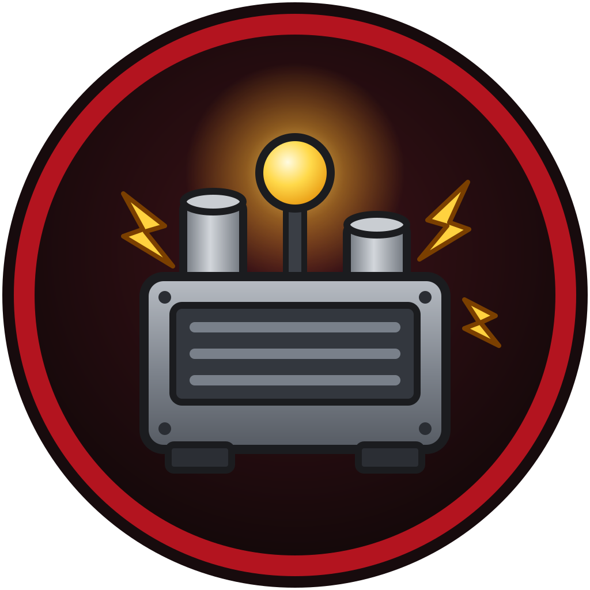

# DbD Rich Presence



Discord status pro **Dead by Daylight**: živě ukazuje, **koho hraješ**, **na jaké mapě**,
**jak dlouho zápas běží** a v lobby i **prestige** tvé postavy.

```
Dead by Daylight
Killer: The Krasue
Rotten Fields (Coldwind Farm)
12:34 uplynulo
```

Program čte obrazovku (OCR přímo v počítači). Do hry nijak nezasahuje: nečte její paměť ani
nemění soubory, jen fotí obrazovku jako OBS nebo Discord při streamování.

## Co umí

- postava včetně legendárních skinů (Rize Kamishiro = The Ghoul), mapa a čas zápasu
- velký portrét postavy a malá ikona mapy, v lobby místo ní odznak prestige (100 odznaků ve složce `odznaky`)
- běh na pozadí bez okna s ikonkou u hodin a spouštění se zapnutím Windows
- nové postavy, mapy a skiny si sám jednou denně doplní z [DbD wiki](https://deadbydaylight.wiki.gg)

## Rychlý start (Windows)

1. Stáhni repozitář (**Code → Download ZIP**) a rozbal ho.
2. Na <https://discord.com/developers/applications> si vytvoř aplikaci se jménem **Dead by Daylight**
   a její **Application ID** vlož do `nastaveni.json`.
3. Ve hře nastav **Windowed Fullscreen** a angličtinu.
4. Spusť **`zapnout_autostart.bat`**. Napoprvé se nainstaluje Python a knihovny (2–5 minut),
   pak program poběží na pozadí a sám počká, až zapneš hru.

Podrobný návod, nastavení a řešení problémů jsou v **[NAVOD.md](NAVOD.md)**.

## Soubory

| | |
|---|---|
| `spustit.bat` | spuštění v okně (s výpisem, na hledání chyb) |
| `zapnout_autostart.bat` / `vypnout_autostart.bat` | běh na pozadí se zapnutím Windows |
| `test_screenshotu.bat` | přetáhni na něj screenshot a uvidíš, co z něj program přečte |
| `diagnostika.bat` | vyfotí obrazovku a vypíše, co na ní program vidí |
| `app/` | samotný program (Python) |
| `odznaky/` | odznaky prestige 1–100 k nahrání do Art Assets |

Dead by Daylight je ochranná známka Behaviour Interactive. Tohle je neoficiální fanouškovský
nástroj; portréty a ikony map se načítají z komunitní DbD wiki.
